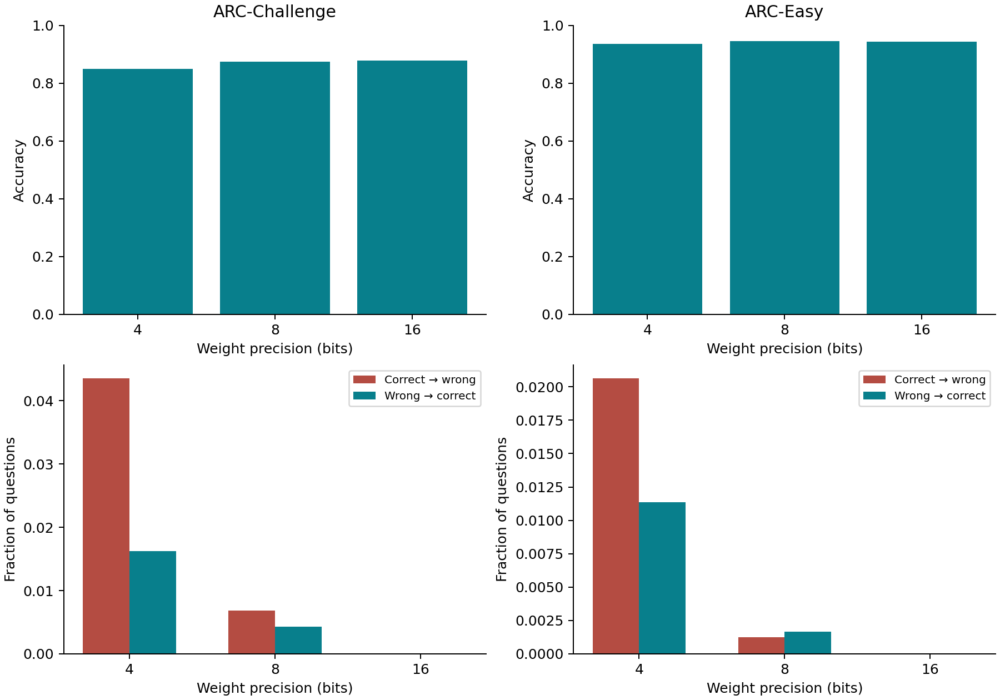
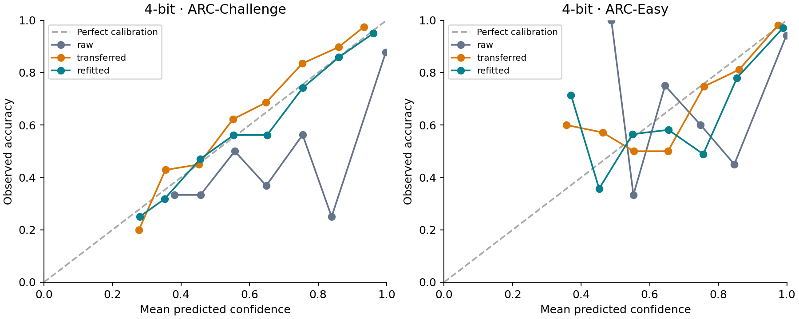
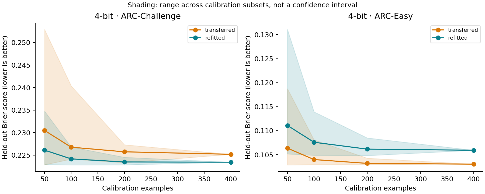
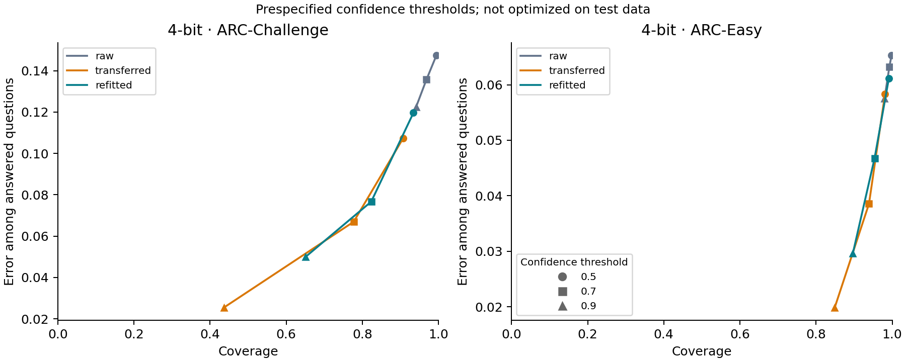

# Quantization and confidence: measured calibration-transfer audit

Status: measured results. This report is generated from saved model scores; no synthetic results are included.

## Primary result

The interval supports little practical difference within the prespecified margin in this setup.

Qwen3-4B / ARC-Challenge / 4-bit / transferred minus refitted / n_cal=400. Paired Brier difference: **0.001749**, 95% bootstrap interval **[-0.003897, 0.008282]**. Positive values favor refitting.

The bootstrap resamples calibration and test questions independently, retains pairing across treatments, and refits temperatures. Brier score measures probability quality, not calibration alone. Positive temperature scaling cannot change the selected option.

## Methods

Official Qwen3 checkpoints were converted to BF16 and MLX affine 8/4-bit weight quantization with group size 64. One model is loaded at a time. Scores are obtained with thinking disabled, identical prompt tokens across precisions, and verified single-token option labels. Probabilities are conditional on the available choices.

For each ARC subset, 100 training questions are reserved for the pilot, 400 disjoint training questions for calibration, and 100 validation questions for pipeline checks. Content, normalized question-stem, and ID overlap are checked across official splits. The primary test is the complete ARC-Challenge test split.

Protocol timing: an initial freeze preceded test scoring. A data-only stem-overlap correction was made before any held-out performance summary was inspected; calibration was refitted and frozen anew. Unchanged raw scores acquired under the initial protocol were reused with per-record provenance. See docs/PROTOCOL-AMENDMENT.md.

## Results

| Model | Dataset | Bits | Treatment | Accuracy | Brier | NLL | ECE |
|---|---|---:|---|---:|---:|---:|---:|
| primary | ARC-Challenge | 16 | raw | 0.8771 | 0.2346 | 1.7874 | 0.1159 |
| primary | ARC-Challenge | 16 | transferred | 0.8771 | 0.1881 | 0.3831 | 0.0275 |
| primary | ARC-Challenge | 16 | refitted | 0.8771 | 0.1881 | 0.3831 | 0.0275 |
| primary | ARC-Challenge | 0 | uniform | 0.2270 | 0.7498 | 1.3859 | 0.0243 |
| primary | ARC-Challenge | 8 | raw | 0.8746 | 0.2383 | 1.7948 | 0.1173 |
| primary | ARC-Challenge | 8 | transferred | 0.8746 | 0.1884 | 0.3835 | 0.0300 |
| primary | ARC-Challenge | 8 | refitted | 0.8746 | 0.1882 | 0.3832 | 0.0307 |
| primary | ARC-Challenge | 4 | raw | 0.8498 | 0.2758 | 1.4804 | 0.1290 |
| primary | ARC-Challenge | 4 | transferred | 0.8498 | 0.2252 | 0.4623 | 0.0444 |
| primary | ARC-Challenge | 4 | refitted | 0.8498 | 0.2234 | 0.4491 | 0.0157 |
| primary | ARC-Easy | 16 | raw | 0.9440 | 0.1078 | 0.8494 | 0.0537 |
| primary | ARC-Easy | 16 | transferred | 0.9440 | 0.0925 | 0.2011 | 0.0283 |
| primary | ARC-Easy | 16 | refitted | 0.9440 | 0.0925 | 0.2011 | 0.0283 |
| primary | ARC-Easy | 0 | uniform | 0.2508 | 0.7498 | 1.3858 | 0.0016 |
| primary | ARC-Easy | 8 | raw | 0.9444 | 0.1082 | 0.8570 | 0.0530 |
| primary | ARC-Easy | 8 | transferred | 0.9444 | 0.0934 | 0.2024 | 0.0289 |
| primary | ARC-Easy | 8 | refitted | 0.9444 | 0.0937 | 0.2039 | 0.0300 |
| primary | ARC-Easy | 4 | raw | 0.9348 | 0.1244 | 0.7092 | 0.0610 |
| primary | ARC-Easy | 4 | transferred | 0.9348 | 0.1030 | 0.2185 | 0.0151 |
| primary | ARC-Easy | 4 | refitted | 0.9348 | 0.1059 | 0.2280 | 0.0277 |
| replication | ARC-Challenge | 16 | raw | 0.7184 | 0.5256 | 2.8726 | 0.2544 |
| replication | ARC-Challenge | 16 | transferred | 0.7184 | 0.3938 | 0.7581 | 0.0540 |
| replication | ARC-Challenge | 16 | refitted | 0.7184 | 0.3938 | 0.7581 | 0.0540 |
| replication | ARC-Challenge | 0 | uniform | 0.2270 | 0.7498 | 1.3859 | 0.0243 |
| replication | ARC-Challenge | 8 | raw | 0.7201 | 0.5256 | 2.7043 | 0.2507 |
| replication | ARC-Challenge | 8 | transferred | 0.7201 | 0.3918 | 0.7549 | 0.0416 |
| replication | ARC-Challenge | 8 | refitted | 0.7201 | 0.3929 | 0.7559 | 0.0510 |
| replication | ARC-Challenge | 4 | raw | 0.6416 | 0.6601 | 3.4126 | 0.3154 |
| replication | ARC-Challenge | 4 | transferred | 0.6416 | 0.4874 | 0.9272 | 0.0566 |
| replication | ARC-Challenge | 4 | refitted | 0.6416 | 0.4847 | 0.9227 | 0.0458 |
| replication | ARC-Easy | 16 | raw | 0.8674 | 0.2434 | 1.3597 | 0.1186 |
| replication | ARC-Easy | 16 | transferred | 0.8674 | 0.1970 | 0.3977 | 0.0210 |
| replication | ARC-Easy | 16 | refitted | 0.8674 | 0.1970 | 0.3977 | 0.0210 |
| replication | ARC-Easy | 0 | uniform | 0.2508 | 0.7498 | 1.3858 | 0.0016 |
| replication | ARC-Easy | 8 | raw | 0.8674 | 0.2445 | 1.3089 | 0.1186 |
| replication | ARC-Easy | 8 | transferred | 0.8674 | 0.1980 | 0.3988 | 0.0175 |
| replication | ARC-Easy | 8 | refitted | 0.8674 | 0.1983 | 0.3988 | 0.0166 |
| replication | ARC-Easy | 4 | raw | 0.7942 | 0.3824 | 1.8876 | 0.1837 |
| replication | ARC-Easy | 4 | transferred | 0.7942 | 0.2935 | 0.5713 | 0.0480 |
| replication | ARC-Easy | 4 | refitted | 0.7942 | 0.2930 | 0.5708 | 0.0453 |

## Resource measurements

| Model | Dataset | Bits | File GB | Peak MLX GB | Mean seconds/question |
|---|---|---:|---:|---:|---:|
| primary | ARC-Challenge | 16 | 8.056 | 8.272 | 0.1187 |
| primary | ARC-Challenge | 8 | 4.286 | 4.589 | 0.1798 |
| primary | ARC-Challenge | 4 | 2.275 | 2.695 | 0.2298 |
| primary | ARC-Easy | 16 | 8.056 | 8.265 | 0.1435 |
| primary | ARC-Easy | 8 | 4.286 | 4.584 | 0.2220 |
| primary | ARC-Easy | 4 | 2.275 | 2.702 | 0.2285 |
| replication | ARC-Challenge | 16 | 3.453 | 3.645 | 0.0775 |
| replication | ARC-Challenge | 8 | 1.840 | 2.218 | 0.1255 |
| replication | ARC-Challenge | 4 | 0.980 | 1.416 | 0.1095 |
| replication | ARC-Easy | 16 | 3.453 | 3.648 | 0.0751 |
| replication | ARC-Easy | 8 | 1.840 | 2.217 | 0.1174 |
| replication | ARC-Easy | 4 | 0.980 | 1.413 | 0.1061 |

## Robustness and limitations

Option-order checks use paired originals and one prespecified permutation per question. They are exploratory; permutations are not new independent observations. See robustness.csv for every cell.

- Two related ARC subsets; at most two sizes of one model family.
- Closed-choice scores, not free-form reliability or reasoning quality.
- MLX affine weight quantization only; pretraining contamination unresolved.
- Secondary comparisons and option permutations are exploratory.

## Interpretation and next steps

A null or inconclusive result does not establish universal equivalence. A positive result is specific to the reported baseline and scoring protocol. Claims about label efficiency should consider the full sample-size curve, including subset variability, rather than its best seed.

Twenty error-analysis slots are prespecified across four prediction-transition categories. If a category has fewer than five examples, the report includes fewer cases rather than substituting favorable examples. Saved cases are in error-cases.json.

## Prior work

- Guo et al. (2017), [On Calibration of Modern Neural Networks](https://proceedings.mlr.press/v70/guo17a.html).
- Proskurina et al. (2024), [When Quantization Affects Confidence](https://aclanthology.org/2024.findings-naacl.124/).
- [Accuracy Is Not All You Need](https://arxiv.org/abs/2407.09141) (2024).
- Zhong et al. (2025), [Quantized Can Still Be Calibrated](https://aclanthology.org/2025.acl-long.1473/).
- [Target-Aware Calibration Data Selection](https://arxiv.org/abs/2608.21019) (2026 preprint).
